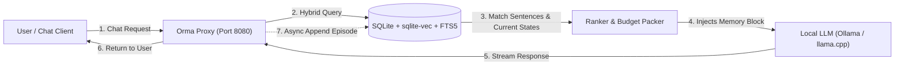
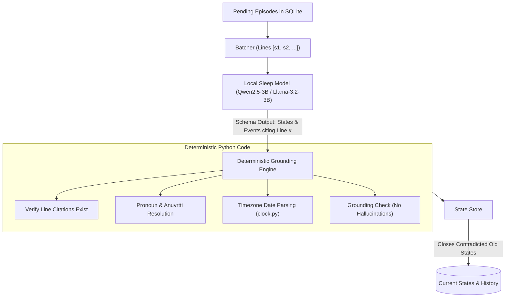

# Orma (ഓർമ്മ)

> **Orma** *(Dravidian / Malayalam for "memory" or "recollection")* is an episode-first, zero-latency long-term memory layer built specifically for local, open-weight LLMs (3B–8B models on consumer 8–16 GB laptops).

[](LICENSE)
[](https://www.python.org/downloads/)
[](tests/)

Orma runs as an **OpenAI-compatible proxy** in front of Ollama, llama.cpp, LM Studio, or vLLM. It also ships a fast CLI and an embedded Python SDK. Everything runs locally inside SQLite with `sqlite-vec` and fast local embeddings—**no external servers, no cloud API keys, and zero data loss.**

---

## Why Orma?

Most agent memory frameworks (like Mem0 or Cognee) were designed for massive cloud models (GPT-4o, Claude 3.5 Sonnet) and enterprise graph databases:
1. **They freeze chat turns:** Calling an LLM synchronously on every `add()` causes 5–15 second freezes on local laptops.
2. **They hallucinate graphs:** 3B models struggle with complex entity-relation extraction and invert relationships or emit malformed JSON.
3. **They permanently corrupt facts:** Prompting a 3B model with `DELETE / UPDATE` leads to destructive, irreversible overwrites.

### The Orma Approach
* **Episodes are the memory:** Every conversation turn, document, or tool log is kept in full in an append-only log and indexed into sentences immediately.
* **Zero LLM calls on recall:** Recall runs in `< 25ms` using hybrid vector search (sqlite-vec) + BM25 full-text search (FTS5) with bounded recency boosting (ACT-R).
* **Sleep consolidates state asynchronously:** While the machine is idle, a background worker uses the local model to extract single-valued current states (`now true`) and dated events citing exact line numbers.
* **Deterministic code guards:** Time resolution, pronoun carry-over (*anuvṛtti*), and contradiction resolution are handled in verified Python code, not by trusting small model arithmetic.

---

## Architecture & Data Flow

### 1. The Fast Request & Recall Path (Zero LLM Calls)



### 2. The Background Sleep Path (Idempotent Consolidation)



---

## Quickstart

### Prerequisites
* Python 3.10+
* [Ollama](https://ollama.ai) or [llama.cpp](https://github.com/ggerganov/llama.cpp)

### 1. Installation

```bash
# Option A: Install from PyPI
pip install orma-ai

# Option B: Install editable from source
git clone https://github.com/wizardwithcodehazard/orma.git
cd orma
python -m venv .venv
source .venv/bin/activate
pip install -e ".[dev]"
```

Run tests to verify the setup (182 tests run deterministically with zero downloads in ~17s):
```bash
python -m pytest -q
```

### 2. Run the Proxy

Pull a lightweight model in Ollama:
```bash
ollama pull llama3.2:3b
```

Start the Orma proxy:
```bash
orma proxy --model llama3.2:3b
# Listening on http://127.0.0.1:8080 (forwarding upstream to http://localhost:11434/v1)
```

Point any OpenAI-compatible client (Open WebUI, Continue.dev, Cursor, or Curl) to `http://localhost:8080/v1`:

```bash
curl http://localhost:8080/v1/chat/completions \
  -H "Content-Type: application/json" \
  -d '{
    "model": "llama3.2:3b",
    "messages": [
      {"role": "user", "content": "I live in Pune and work on compilers."}
    ]
  }'
```

### 3. Inspect Memory

```bash
# Add a quick note or document
orma add "My dentist is Dr. Rao in Kothrud."
orma add docs/notes.md

# Search memory
orma search "Where is my dentist?"

# View active facts & history
orma facts --history

# Trigger background sleep manually
orma sleep --model llama3.2:3b
```

---

## Python SDK

```python
from orma import Memory

# Initialize memory (default SQLite db: ~/.orma/memory.db or ORMA_DIR)
mem = Memory(upstream="http://localhost:11434/v1", model="llama3.2:3b")

# Add memories directly
mem.add("I moved from Pune to Bangalore last week.", role="user")
mem.add_file("project_notes.txt")

# Build context for an outgoing prompt (hybrid search + current states)
messages = mem.build_context([
    {"role": "user", "content": "Where do I currently live?"}
])

# Stream or call your model
reply = mem.chat([{"role": "user", "content": "Where do I live?"}])
print(reply)

# Background consolidation
mem.sleep()

# Rebuild all memory from scratch using a stronger model if needed
# mem.rebuild()

mem.close()
```

---

## Memory Prompt Output Format

When Orma recalls memories, it packs them into a tight token budget injected into the system prompt:

```markdown
## Memory
What you remember about the person you are talking to. Today is 2026-10-24.

Now true:
- user · home city: Bangalore (since 2026-10-17)

Things said before:
- 2026-10-10 user: I'm Sahil and I live in Pune. [outdated: now user · home city: Bangalore]
- 2026-10-18 user: Last Saturday I went trekking to Sinhagad with my sister Asha.

Events:
- 2026-10-12: user went trekking at Sinhagad with Asha
```

---

## Comparison: Orma vs. Mem0 & Cognee

| Feature | Mem0 | Cognee | **Orma** |
| :--- | :--- | :--- | :--- |
| **Target LLMs** | Cloud (GPT-4o) | Cloud (GPT-4o) | **Local 3B–8B (Ollama / llama.cpp)** |
| **Write Overhead** | Synchronous LLM calls (5–15s delay) | Multi-stage graph pipelines | **Instant (< 5ms SQLite append)** |
| **Recall Overhead** | Vector + LLM synthesis | Graph traversal + LLM | **Instant (< 25ms hybrid search, 0 LLM calls)** |
| **Data Safety** | Destructive `DELETE / UPDATE` | Lossy graph extraction | **Lossless append-only logs (`rebuild` anytime)** |
| **Hallucination Protection** | Relies on LLM accuracy | Relies on Pydantic output | **Line citations + deterministic Python guards** |

---

## Configuration & Ablation Switches

Orma comes with built-in ablation switches in `smruti/config.py` to evaluate every mechanism against raw episodic baselines:

* `enable_semantic`: Toggle state and event extraction (off = pure episodic sentence search baseline).
* `enable_novelty_gate`: Drops near-duplicate records ($\ge 0.97$ cosine similarity).
* `enable_similarity_weighting`: Calibrates vector similarity against adaptive space noise floor.
* `enable_base_level`: Enables ACT-R recency and repetition boost.

---

## License

Distributed under the **Apache-2.0 License**. See [LICENSE](LICENSE) for more information.
