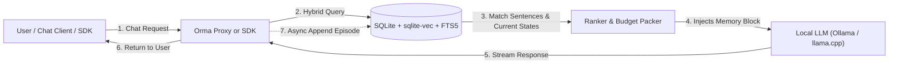
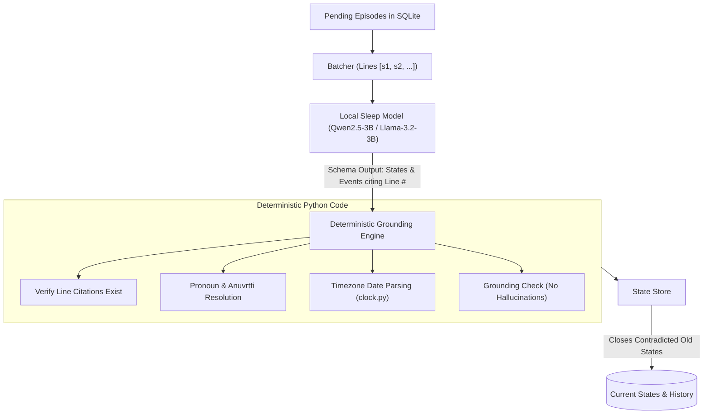

# Orma (ഓർമ്മ)

> **Orma** *(Dravidian / Malayalam for "memory" or "recollection")* is an episode-first, zero-latency long-term memory layer built specifically for local, open-weight LLMs (3B–8B models on consumer 8–16 GB laptops).

[](https://pypi.org/project/orma-ai/)
[](LICENSE)
[](https://www.python.org/downloads/)
[](tests/)

Orma can be used in two ways:
1. **As a native Python SDK (`from orma import Memory`)** for direct integration into your agents, chatbots, and apps (like Mem0 and Cognee).
2. **As an OpenAI-compatible proxy (`orma proxy` or `orma up`)** that transparently adds long-term memory to any LLM tool, client, or framework with zero code changes.

Everything runs locally in SQLite with `sqlite-vec` and fast on-device embeddings—**no external servers, no cloud API keys, and zero data loss.**

---

## Why Orma vs. Mem0 & Cognee?

Most agent memory frameworks (like Mem0 or Cognee) were designed for massive cloud models (GPT-4o, Claude 3.5 Sonnet) and enterprise graph databases:
1. **They freeze chat turns:** Calling an LLM synchronously on every `add()` causes 5–15 second freezes on local machines.
2. **They hallucinate graphs:** 3B models struggle with complex entity-relation extraction and emit malformed JSON or inverted relations.
3. **They permanently corrupt facts:** Prompting small models with destructive `DELETE / UPDATE` instructions leads to accidental data loss.

### The Orma Approach
* **Episodes are the memory:** Every conversation turn, document, or tool log is kept in full in an append-only log and indexed into sentences immediately.
* **Zero LLM calls on recall:** Recall runs in `< 25ms` using hybrid vector search (sqlite-vec) + BM25 full-text search (FTS5) with bounded recency boosting (ACT-R).
* **Sleep consolidates state asynchronously:** While the machine is idle, a background worker uses the local model to extract single-valued current states (`now true`) and dated events citing exact line numbers.
* **Deterministic code guards:** Time resolution, pronoun carry-over (*anuvṛtti*), and contradiction resolution are handled in verified Python code, not by trusting small model arithmetic.

| Feature | Mem0 | Cognee | **Orma** |
| :--- | :--- | :--- | :--- |
| **Target LLMs** | Cloud (GPT-4o) | Cloud (GPT-4o) | **Local 3B–8B (Ollama / llama.cpp)** |
| **Python SDK** | `Memory()` | `cognee.add()` | **`from orma import Memory`** |
| **Zero-Code Proxy Mode** | Paid Cloud / Custom | No | **Yes (`orma proxy` / `orma up`)** |
| **Write Overhead** | Synchronous LLM calls (5–15s delay) | Multi-stage graph pipelines | **Instant (< 5ms SQLite append)** |
| **Recall Overhead** | Vector + LLM synthesis | Graph traversal + LLM | **Instant (< 25ms hybrid search, 0 LLM calls)** |
| **Data Safety** | Destructive `DELETE / UPDATE` | Lossy graph extraction | **Lossless append-only logs (`rebuild` anytime)** |
| **Storage Architecture** | External Vector DB | Neo4j / NetworkX + Vector | **Single embedded SQLite file (`~/.orma/memory.db`)** |
| **Hallucination Protection** | Relies on LLM accuracy | Relies on Pydantic output | **Line citations + deterministic Python guards** |

---

## Architecture & Data Flow

### 1. The Fast Request & Recall Path (Zero LLM Calls)



### 2. The Background Sleep Path (Idempotent Consolidation)



---

## Installation

```bash
pip install orma-ai
```

Or install from source for development:
```bash
git clone https://github.com/wizardwithcodehazard/orma.git
cd orma
pip install -e ".[dev]"
python -m pytest -q  # 197 tests pass locally
```

---

## Usage Option 1: Python SDK (Direct In-Code Integration)

Use the Python SDK to embed Orma directly into your agents, pipelines, or web applications:

```python
from orma import Memory

# 1. Initialize memory (defaults to ~/.orma/memory.db)
mem = Memory(
    upstream="http://localhost:11434/v1",  # Ollama or llama.cpp endpoint
    model="llama3.2:3b"                     # Model for background sleep consolidation
)

# 2. Add memories, documents, or ongoing chat turns
mem.add("I work as a backend engineer and I live in Pune.")
mem.add_file("project_notes.md")

# Record chat interactions
mem.observe(role="user", text="I moved from Pune to Bangalore last week.")
mem.observe(role="assistant", text="Congratulations on the move to Bangalore!")

# 3. Retrieve formatted context for prompt injection
messages = [{"role": "user", "content": "Where do I currently live?"}]
prompt_messages = mem.build_context(messages)
# prompt_messages contains a system prompt with current facts, outdated facts marked, and relevant quotes!

# 4. Search memory directly
results = mem.search("Where is my home?")
for state in results.states:
    print(state.text)  # "user · home city: Bangalore"

# 5. Background consolidation (extracts facts and closes outdated ones)
report = mem.sleep()
print(report)

mem.close()
```

---

## Usage Option 2: Zero-Code Proxy (OpenAI SDK, LangChain, Cursor, Open WebUI)

Start Orma as a local proxy:
```bash
# With Ollama
orma proxy --model llama3.2:3b

# Or with llama.cpp
orma proxy --upstream http://127.0.0.1:9931 --model "Qwen/Qwen2.5-3B-Instruct-GGUF:Q4_K_M"
```

Then point any client to `http://localhost:8080/v1`:

### With the Official OpenAI Python Client:
```python
from openai import OpenAI

client = OpenAI(
    base_url="http://localhost:8080/v1",
    api_key="none"
)

response = client.chat.completions.create(
    model="llama3.2:3b",
    messages=[{"role": "user", "content": "What is my job and where do I live?"}]
)
print(response.choices[0].message.content)
```

### With LangChain:
```python
from langchain_openai import ChatOpenAI

llm = ChatOpenAI(
    base_url="http://localhost:8080/v1",
    api_key="none",
    model="llama3.2:3b"
)
```

### With Open WebUI, AnythingLLM, or Cursor:
* Set OpenAI Base URL to: `http://localhost:8080/v1`
* Set API Key to: `none`

---

## Usage Option 3: One-Command Web UI (`orma up`)

If you are using llama.cpp or Ollama with a browser web UI, run:

```bash
orma up --upstream http://127.0.0.1:9931 --model "Qwen/Qwen2.5-3B-Instruct-GGUF:Q4_K_M"
```

This immediately:
1. Starts the Orma memory proxy on port 8080.
2. Automatically opens your default web browser to `http://127.0.0.1:8080/#/`.
3. Passes through the web UI frontend while transparently routing all chat completions through Orma's memory layer.

---

## Multi-User & Multi-Tenant Isolation

Orma supports isolated memory spaces out of the box so multiple users or agent sessions don't contaminate each other's memories:

* **In Python SDK:**
  ```python
  mem.add("Alice likes green tea.", space="user_alice")
  context = mem.build_context(messages, space="user_alice")
  ```
* **In HTTP Requests / Proxies:**
  Pass the `x-orma-space` header or `"user"` field:
  ```bash
  curl http://localhost:8080/v1/chat/completions \
    -H "x-orma-space: user_123" \
    -H "Content-Type: application/json" \
    -d '{"messages": [{"role": "user", "content": "Who am I?"}]}'
  ```

---

## CLI Reference

Orma provides a command-line tool for managing your memory:

```bash
# Add a note or document
orma add "My dentist is Dr. Rao in Kothrud."
orma add docs/handbook.md

# Search memory
orma search "dentist"

# Inspect active facts and outdated history
orma facts --history

# Preview the exact prompt block that would be injected
orma recall "Who is my dentist?"

# Manually trigger sleep consolidation
orma sleep --model llama3.2:3b

# Forget a specific fact
orma forget 12

# Database statistics
orma stats
```

---

## Memory Prompt Output Format

When Orma recalls memories, it packs them into a token-budgeted block injected into the system prompt:

```markdown
## Memory
What you remember about the person you are talking to. Today is 2026-10-24.

Now true:
- user · home city: Bangalore (since 2026-10-17)

Things said before:
- 2026-10-10 user: I'm Sahil and I live in Pune. [outdated: now user · home city: Bangalore]
- 2026-10-18 user: Last Saturday I went trekking to Sinhagad with my sister Asha.

Events:
- 2026-10-12: user went trekking at Sinhagad with Asha
```

---

## Cognitive & Mathematical Architecture

Orma integrates established principles from cognitive science and stochastic temporal processes directly into its zero-latency retrieval engine:

### 1. Hawkes Self-Exciting Temporal Process (`enable_hawkes`)
Conversations naturally exhibit temporal burstiness—discussing a topic triggers immediate follow-ups. Orma models this using a self-exciting Hawkes kernel with exponential decay:
* **Burst Momentum**: Mentions generate a transient activation burst (`alpha = 0.4`) that decays with a 30-minute half-life (`half_life = 1800s`).
* **Clean Falloff**: Recent conversation topics gain immediate conversational momentum without permanently distorting baseline long-term retrieval.

### 2. Ebbinghaus Spaced Repetition Stability (`enable_ebbinghaus`)
Human memory consolidation follows the spacing effect: repeated retrieval over time cements knowledge, whereas single mentions fade.
* **Dynamic Stability**: Memory stability `S` expands with spaced rehearsals: `S = S0 * (1 + gain * (n - 1))` (where `S0 = 2.0` days, `gain = 0.5`).
* **Robust Retention**: Frequently confirmed user facts withstand temporal decay, while transient one-off details gracefully yield budget space.

### 3. ACT-R Spreading Activation & The Fan Effect (`enable_spreading_activation`)
Memories are not isolated strings; they are interconnected nodes in a personal knowledge network.
* **Associative Spread**: When a query recalls a target entity, activation propagates to related states and entities without requiring heavy graph databases.
* **Anderson's Fan Effect**: Activation divided by source fan (`Weight / Fan`). Specific, specialized entities (e.g., `"Dr. Rao"`) channel concentrated associative recall, while generic hub nodes (e.g., `"city"`) do not drown out relevant facts.

### 4. Defeasible Epistemic Logic (`enable_defeasible_logic`)
Human preferences are non-monotonic and context-dependent.
* **Conditional Invariance**: Orma distinguishes between categorical facts (`"I drink black coffee every morning"`) and defeasible conditional overrides (`"When I have a sore throat, I drink ginger tea with honey"`).
* **No False Contradictions**: Situational rules and exceptions do not close or overwrite baseline truths in memory consolidation.

---

## Storage & Data Durability (100% Local & Persistent)

* **Single File SQLite Storage**: All memories reside in `~/.orma/memory.db` with Write-Ahead Logging (WAL) enabled.
* **Survives Restarts & Power Cycles**: You can shut down `orma up`, restart your machine, or close your terminal at any time; your complete memory state, episodic history, and consolidated facts remain permanently stored.
* **Lossless Append-Only**: Episodes are never destructively overwritten or pruned by hallucinating models. You can inspect or re-consolidate your history anytime with `orma facts --history`.

---

## Configuration & Ablation Switches

Every mechanism in Orma can be independently configured or ablated in [orma/config.py](file:///c:/Users/Sahil/Desktop/memory_layer/smruti/orma/config.py) or passed via `OrmaConfig`:

| Parameter | Default | Description |
| :--- | :--- | :--- |
| `enable_semantic` | `True` | Background consolidation into states & events (off = pure episodic sentence search baseline) |
| `enable_novelty_gate` | `True` | Drops duplicate sentences (cosine similarity >= 0.97) |
| `enable_similarity_weighting` | `True` | Calibrates vector similarity against adaptive space noise floor |
| `enable_base_level` | `True` | ACT-R recency and frequency power-law decay |
| `enable_hawkes` | `True` | Hawkes self-exciting temporal process for conversational bursts |
| `enable_ebbinghaus` | `True` | Ebbinghaus spaced repetition stability scaling |
| `enable_spreading_activation` | `True` | Associative spreading activation with Fan Effect |
| `enable_defeasible_logic` | `True` | Non-monotonic conditional exception protection |
| `budget_tokens` | `4096` | Token budget ceiling for injected memory blocks |
| `search_k` | `30` | Top-k candidates pulled per hybrid search channel |
| `rrf_k` | `60` | Reciprocal Rank Fusion constant for combining BM25 and vector scores |

---

## License

Distributed under the **Apache-2.0 License**. See [LICENSE](LICENSE) for more information.
