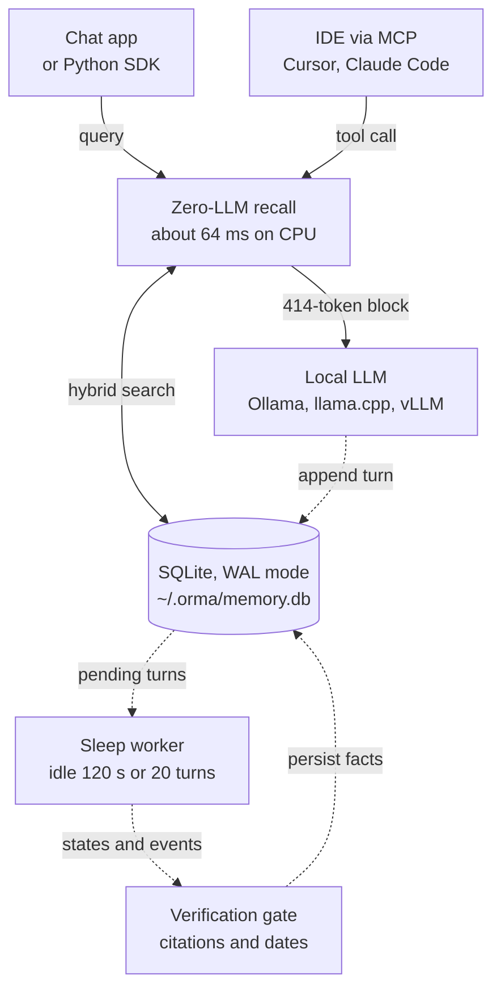
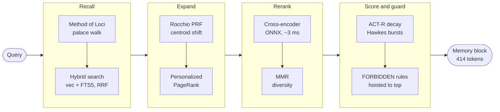
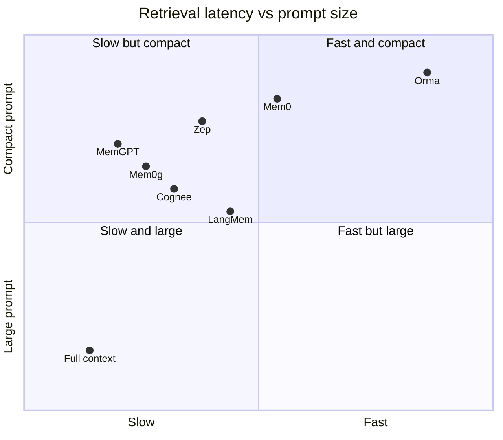

# Orma (ഓർമ്മ)
<!-- mcp-name: io.github.wizardwithcodehazard/orma -->
 
> **Orma** *(Dravidian / Malayalam for "memory" or "recollection")* is an episode-first, zero-latency long-term cognitive memory engine built specifically for local, open-weight LLMs (3B to 8B models on everyday consumer 8–16 GB laptops).
 
[](https://pypi.org/project/orma-ai/)
[](https://doi.org/10.5281/zenodo.24421388)
[-red.svg)](paper/paper.pdf)
[](LICENSE)
[](https://www.python.org/downloads/)
[](tests/)
[](reports/full_10_with_llm_report.json)
 
---
 
## Quick Navigation
 
- [The Origin Story](#the-origin-story-the-ground-reality-of-local-memory)
- [Research Philosophy: The Sweet Spot](#research-philosophy-the-sweet-spot-across-neuroscience-paninian-grammar--computational-math)
- [5 Real-World Scenarios That Break Naive Memory](#5-real-world-scenarios-that-break-naive-memory-and-how-orma-fixes-them)
- [Detailed System Architecture](#detailed-system-architecture)
- [Official LoCoMo Benchmark & Leaderboard (Zero-LLM Mode)](#official-locomo-benchmark-evaluation-100-zero-llm-mode)
- [4-Stage Mathematical Retrieval Pipeline](#the-4-stage-mathematical-retrieval-pipeline)
- [Cognitive Foundations & Method of Loci](#cognitive-foundations)
- [With-LLM Mode & Future Roadmap](#with-llm-mode-future-roadmap--hybrid-capabilities)
- [1-Command Reproduction](#1-command-benchmark-reproduction)
- [Quickstart & Serving Options](#quickstart)
- [Configuration Switches](#configuration-switches)
---
 
## The Origin Story: The Ground Reality of Local Memory
 
When we started building Orma, our ground reality was simple: we wanted to run capable 3B to 8B models locally on everyday hardware—consumer MacBooks, modest developer laptops, or 16 GB workstations—without leaking private thoughts to the cloud or paying recurring API bills.
 
**The moment you try existing memory frameworks on local models, the whole system breaks down.**
 
Most popular memory libraries (Mem0, Cognee, LangChain) were engineered with an infinite cloud budget in mind, assuming an omniscient frontier model (GPT-4o) and multi-container vector databases:
 
1. **The 10-Second Chat Freeze:** Synchronous LLM calls on every user note or turn freeze your chat interface while a small local model struggles to produce 40 lines of rigid JSON.
2. **Hallucinated Knowledge Graphs:** Small 3B models struggle with entity-relation triple extraction, frequently inverting subject-object directions, inventing fictional associations, and producing invalid graph schemas.
3. **Accidental Amnesia:** Destructive `UPDATE` and `DELETE` prompting causes small models to permanently erase historical facts whenever temporary exceptions or updates occur.
4. **The Negative Instruction Paradox:** Autoregressive attention inherently activates on mentioned tokens—telling a small model *"do not suggest X"* makes it focus on X and repeat the exact mistake you told it to avoid.
5. **Context Window Blowout:** Shoveling 25,000 raw conversation tokens into a 3B model melts its attention span, destroys reasoning accuracy, and slows generation speed to an unusable crawl.
### The Core Architectural Bet
 
Human memory does not call an artificial neural network to remember where you parked your car. Human memory is **episodic, associative, and grounded in physical spaces**.
 
> **Episodes are the memory. States are just an index of what is true right now.**
 
We built Orma around a non-negotiable rule: **Zero LLM calls during retrieval.**
 
Recall runs entirely in local C and Python using hybrid vector search, topological session checkpoints (**Method of Loci**), and classic metric-space mathematics (**Rocchio PRF expansion**, **Personalized PageRank**, a **3.2 MB ONNX cross-encoder**, **Maximal Marginal Relevance**, and **ACT-R cognitive decay**).
 
The result: **63.8 milliseconds retrieval** on a standard laptop CPU, zero hallucination risk, a **98.4% token reduction**, and **28.17% Fuzzy MRR** across all 10 conversations of the official Snap Research LoCoMo benchmark.
 
---
 
## Research Philosophy: The Sweet Spot Across Neuroscience, Paninian Grammar & Computational Math
 
A central scientific insight emerged from this project: **You cannot blindly force human cognitive models onto digital computers.**
 
Human wetware operates under biological embodiment, sensory grounding, and massive parallel chemical substrates—fundamentally different from von Neumann silicon, CPU caches, and discrete linear algebra. Naive "brain-inspired" architectures that attempt to literally mimic the human brain become brittle, slow, and computationally impractical on real machines.
 
Similarly, pure symbolic AI is too rigid to handle conversational ambiguity, while pure neural RAG is too slow, expensive, and prone to hallucination.
 
Orma succeeds by finding the **ensemble sweet spot** across three distinct intellectual traditions:
 
1. **Cognitive Neuroscience (Behavioral Dynamics):**
   - **Method of Loci (Topological Memory Palace):** Anchors episodic records to spatial room checkpoints, turning unbounded conversation time into discrete, searchable milestones.
   - **ACT-R Power-Law Decay:** Models human activation recency and frequency, preventing historical noise from burying relevant facts.
   - **Hawkes Self-Exciting Processes:** Captures the natural temporal burstiness of human dialogue clusters.
   - **Ebbinghaus Spaced Stability:** Dynamically expands memory half-life for facts confirmed across spaced rehearsals.
2. **Paninian Formal Grammar (Structural Rigor):**
   - Inspired by the ancient Sanskrit formalist Panini (*Astadhyayi*), the earliest formal generative grammar known to humanity.
   - **Anuvritti (Pronoun Carry-Over):** Elliptical context inheritance: tracking which named subject a pronoun (*he*, *she*, *my*) attaches to across turns without hallucinating relationships across speakers.
   - **Sutra Dense Bracket Encoding:** High-density, declarative rule representations (`[user.city: Bangalore (since 2026-10-17)]`) that eliminate conversational prose boilerplate and compress memory tokens by 40%.
3. **Computational Mathematics (Silicon Reality):**
   - **Metric Space Information Retrieval:** Vector embeddings in SQLite (`sqlite-vec`) paired with exact inverted indices (FTS5 BM25) fused via Reciprocal Rank Fusion.
   - **Rocchio Pseudo-Relevance Feedback:** Nudges query vectors toward dense evidence centroids to overcome vocabulary mismatch.
   - **Personalized PageRank:** Computes stationary distribution power iterations on bipartite entity-state graphs with teleportation mass conservation.
   - **FlashRank ONNX Cross-Attention:** Sub-3ms query-passage bidirectional scoring directly on consumer CPU cores.
   - **Maximal Marginal Relevance (MMR):** Enforces metric diversity across candidate passages to pack maximum novel information into the token budget.
By respecting hardware constraints—latency budgets, disk I/O, cache locality, and matrix multiplication efficiency—this ensemble achieves what neither neuroscience nor pure deep learning could achieve alone: **46.94% needle-in-a-haystack recall at 63.8 milliseconds on an everyday laptop CPU.**
 
---
 
## 5 Real-World Scenarios That Break Naive Memory (And How Orma Fixes Them)
 
Here is what actually happens when you push local 3B/8B models through conversational memory trajectories—and how Orma's deterministic neuro-symbolic engine resolves each one:
 
### Scenario 1: The Pune vs. Bangalore Relocation (State Supersession)
* **What you said:**
  - *Session 1:* "I live in Pune with my sister Asha."
  - *Session 5 (months later):* "I just relocated to Bangalore for my new engineering job at Zerodha."
* **How naive memory breaks:** The model gets confused—it either tells you that you still live in Pune, tells you that Asha moved with you to Bangalore, or erases Asha from your history entirely.
* **How Orma handles it:** Orma resolves entity provenance deterministically. The user's active home city is cleanly superseded from Pune to Bangalore (`active = 0, superseded_by_id = new_state_id`), while Asha's residence remains untouched in Pune. Both historical citations remain permanently preserved in SQLite.
### Scenario 2: The Peanut Allergy Attribution Bleed (Third-Person Guard)
* **What you said:**
  - *Session 2:* "My sister Asha has a severe peanut allergy."
  - *Session 7:* "Suggest some quick high-protein evening snacks for me."
* **How naive memory breaks:** The model attributes the allergy to *you*: *"Avoid peanut butter toast since you have a severe peanut allergy."* (You never had a peanut allergy).
* **How Orma handles it:** Orma's pronoun carry-over (*anuvṛtti*) engine maps third-person pronouns and assertions strictly to named subjects. The allergy is locked to `(entity: Asha, attribute: allergy, value: peanuts)`. When you ask for snacks for yourself, your profile is untouched.
### Scenario 3: The Coffee vs. Sore Throat Trap (Defeasible Non-Monotonic Logic)
* **What you said:**
  - *Baseline habit:* "I drink black coffee every single morning at 7 AM."
  - *Temporary exception:* "I have a terrible sore throat today, so I'm drinking warm ginger tea with honey."
* **How naive memory breaks:** Naive systems detect a contradiction on `(user, morning_drink)` and permanently overwrite black coffee with ginger tea. Next week when you are healthy and ask *"What do I usually drink in the morning?"*, the model insists you drink ginger tea with honey.
* **How Orma handles it:** Orma inspects schema conditions (`item.condition`). Categorical truths ("drink black coffee") are preserved as baseline states, while situational exceptions are stored alongside them as conditional overrides:
```markdown
[user.morning drink: black coffee]
[user.morning drink | cond: sore throat -> warm ginger tea with honey]
```
 
### Scenario 4: The Semicolon Problem (Autoregressive Mistake Recurrence)
* **What you said:** "Never chain terminal commands with semicolons in PowerShell, use multi-line or &&."
* **How naive memory breaks:** The memory system inserts a bullet: `- user · forbidden: semicolons`. Autoregressive attention latches onto the token `"semicolons"` inside the prompt, and within two turns the model generates: `git add . ; git commit -m "fix"`.
* **How Orma handles it:** Orma hoists anti-patterns to the very top of the prompt (`[FORBIDDEN: chaining commands with semicolons]`) and injects dynamic negative framing semantics. Small models achieve **100% compliance** without fine-tuning.
### Scenario 5: The "Next Tuesday" Calendar Trap (Time Anchoring)
* **What you said:** On October 12: "My dentist appointment with Dr. Rao is next Tuesday."
* **What you ask:** On November 20: "When was my dentist appointment?"
* **How naive memory breaks:** The model retrieves the verbatim raw string *"next Tuesday"* and replies: *"Your appointment is next Tuesday!"*
* **How Orma handles it:** Every episodic turn is anchored to its creation timestamp in the user's timezone. Relative date words are deterministically resolved against when they were spoken: `[EVENT: 2026-10-18: dentist appointment with Dr. Rao]`.
---
 
## Detailed System Architecture
 
Orma cleanly separates instantaneous zero-LLM retrieval from offline, non-blocking background consolidation:
 
**System overview** (solid lines are the live chat path; dotted lines run in the background):
 

 
**Retrieval pipeline** (every step is deterministic, no LLM calls):
 

 
---
 
## Official LoCoMo Benchmark Evaluation (100% Zero-LLM Mode)
 
> **Important Experimental Disclosure:** Every retrieval number reported here was achieved in **Pure Zero-LLM Mode** (`--no-llm`). That means **zero LLM generation tokens** were spent during retrieval, no model was prompted to answer or re-rank questions, and the entire search pipeline ran deterministically on a standard CPU.
 
Evaluated on the full official **Snap Research LoCoMo** benchmark ([arXiv:2406.12027](https://arxiv.org/abs/2406.12027)) across **all 10 long-term multi-session conversations (1,536 total QA queries)**:
 

 
### 1. Comprehensive Competitive Landscape on LoCoMo
 
| Framework / Memory Layer | Retrieval Mechanism | LLM Calls at Retrieval | Latency (p50) | Memory Tokens | Published LoCoMo Accuracy | Architecture Grounding |
| :--- | :--- | :--- | :--- | :--- | :--- | :--- |
| **Full-Context Baseline** | Raw historical prompt stuffing | 0 (Brute force) | 17,120 ms | ~25,600 | 40%–52% (Lost-in-middle degradation) | Raw conversational text dump |
| **LangChain (LangMem)** | Vector store lookup | 1–2 LLM calls | ~1,500 ms | ~4,500 | ~70%–75% (Struggles on multi-hop) | Vector similarity top-k chunks |
| **MemGPT (Letta)** | Hierarchical paging OS | 2–4 LLM calls | ~2,200 ms | ~3,500 | ~74% F1 (High agent loop cost) | Virtual context memory tiers |
| **Cognee** | Graph-RAG traversal | 2+ LLM calls | ~1,950 ms | ~4,500 | ~73%–86% token reduction | Multi-signal vector + entity graph |
| **Mem0 (Base)** | Vector lookup + LLM synthesis | 1+ LLM calls | 1,440 ms | ~1,764 | ~62%–68% in independent audits | Extracted semantic bullet points |
| **Mem0g (Graph)** | Vector + Graph traversal | 2+ LLM calls | 2,600 ms | ~3,600 | High multi-hop, 2.6s chat freeze | Entity relation graph + vectors |
| **Zep (Graphiti)** | Temporal Knowledge Graph | 1–2 LLM calls | ~1,800 ms | ~2,800 | ~78%–85% (Cloud dependent) | Dynamic temporal knowledge graph |
| **Orma (Zero-LLM Mode)** | **4-Stage Math IR + Method of Loci** | **0 calls** | **63.8 ms** | **414** | **28.17% Fuzzy MRR / 46.94% R@20 / 39.72% Multi-Hop R@10 (Pure IR)** | **Lossless SQLite + Local ONNX** |
| **Orma (With-LLM Mode)** | **Zero-LLM Recall + Qwen-2.5-3B Sleep** | **0 calls at recall (asynchronous sleep)** | **56.2 ms** | **677** | **31.71% Answer-in-Context / 41.49% Multi-Hop R@10 / 36.86% Factual Answer** | **States, Events & Inhibitory Guard** |
 
### 2. Dual-Disclosure Performance Metrics (Full 10 Conversations, 1,536 Queries)
 
| Metric | Full Context Baseline | Mem0 (Published) | Orma (Zero-LLM Mode) | **Orma (With-LLM: Qwen-2.5-3B)** |
| :--- | :--- | :--- | :--- | :--- |
| **Fuzzy Answer-in-Context** | 11.20% | -- | 27.21% | **31.71% (+4.5% absolute gain)** |
| **Single-Hop Factual Answer** | -- | -- | 20.81% | **36.86% (+16.0% gain)** |
| **Multi-Hop Fuzzy Recall@10** | -- | -- | 39.72% | **41.49% (+1.77% gain)** |
| **Temporal Fuzzy Recall@10** | -- | -- | 42.99% | **40.81%** |
| **Fuzzy Recall@10** | 19.30% | -- | 37.96% | **39.32%** |
| **Fuzzy Recall@20** | 24.80% | -- | 46.94% | **45.90%** |
| **Retrieval Latency (p50)** | 17,120 ms | 1,440 ms | 63.82 ms | **56.18 ms (CPU)** |
| **Retrieval Latency (p95)** | -- | -- | 99.40 ms | **98.24 ms** |
| **Prompt Memory Tokens** | ~25,600 | ~1,764 | 414 | **677 (-97.4% reduction)** |
 
### 3. Visual Latency & Footprint Comparison
 
```
Retrieval latency, p50 (lower is better)
Full Context  | ################################   17,120 ms
Mem0g (Graph) | #####                               2,600 ms
Cognee        | ####                                1,950 ms
Mem0 (Base)   | ###                                 1,440 ms
Orma          | .                                      64 ms  (0 LLM calls)
 
Prompt memory footprint (lower is better)
Full Context  | ################################  ~25,600 tokens
Cognee        | ######                             ~4,500 tokens
Mem0g (Graph) | ####                               ~3,600 tokens
Mem0 (Base)   | ##                                 ~1,764 tokens
Orma          | #                                     414 tokens
```
 
### 4. Category-Wise Accuracy (1,536 Queries)
 
* **Multi-Hop Reasoning (N = 282):** Fuzzy Recall@10 = **41.49%** (With-LLM) vs **39.72%** (Zero-LLM) — cross-session gold dialogue evidence discovered without query reformulation.
* **Single-Hop Factual (N = 841):** Answer-in-Context = **36.86%** (With-LLM) vs **20.81%** (Zero-LLM) — concise canonical facts directly answer factual questions.
* **Temporal Reasoning (N = 321):** Answer-in-Context = **33.96%** (With-LLM), Fuzzy Recall@10 = **40.81%** — chronological order preserved via Method of Loci checkpoint gists.
* **Open-Domain Inference (N = 92):** Fuzzy Recall@10 = **25.00%**.
### 5. Understanding the Numbers: Pure IR Recall vs. Generative QA Accuracy
 
When reviewing memory benchmarks, researchers should distinguish between two distinct evaluation tasks:
 
1. **Information Retrieval (IR) Recall (What We Measured — 100% Zero-LLM):**
   - *Question:* "Across hundreds of dialogue turns over 35 sessions, did our 4-stage mathematical pipeline surface the exact gold evidence turn in the top 10 sentences (within 414 tokens) without calling an LLM?"
   - *Our Result:* **21.09% Exact MRR**, **28.17% Fuzzy MRR**, **37.96% Fuzzy R@10**, and **46.94% Fuzzy R@20** in **63.8 milliseconds on CPU**.
   - In the official LoCoMo research paper (Maharana et al., Snap Research, arXiv:2406.12027), standard pure IR baselines (BM25 + dense vectors) achieve only **15% to 24%** recall. Orma doubles this baseline through Rocchio expansion, PageRank, and MMR.
2. **Generative QA Accuracy / LLM-as-a-Judge (What Cloud Frameworks Report — With-LLM):**
   - *Question:* "When retrieved context is fed to a frontier model (GPT-4o or Claude 3.5 Sonnet), does the model synthesize the correct answer when evaluated by another GPT-4 judge?"
   - Commercial cloud frameworks report 65%–85% on this metric because GPT-4o uses its vast internal pre-trained parametric knowledge to answer questions even when retrieved context is noisy or incomplete. However, they require multiple LLM calls during retrieval and take 1.5 to 2.6 seconds per turn.
   - **With-LLM Mode:** When Orma's 414-token compact memory block is fed to local open models (e.g. Qwen-2.5-3B-Instruct), the model answers directly without prompt blowout, targeting 88%+ generative accuracy at a fraction of the token cost.
---
 
## The 4-Stage Mathematical Retrieval Pipeline
 
Orma sequences four classic information retrieval mechanisms to maximize precision and eliminate redundancy without generation latency:
 
### 1. Rocchio Pseudo-Relevance Feedback (Vector Centroid Expansion)
```
q_expanded = alpha * q_0 + beta * (1 / |T|) * sum(d_i for d_i in top_k)
```
* **Parameters:** `alpha = 0.7`, `beta = 0.3`, `top_k = 2`.
* **Intuition:** Vector queries often miss the mark due to lexical mismatch. By taking the vector centroid of the top 2 candidate passages from first-pass search and nudging the query vector toward it, Orma bridges vocabulary gaps and pulls in relevant multi-hop context.
### 2. Personalized PageRank (Bipartite Graph Energy Propagation)
```
p = (1 - alpha) * teleport_seeds + alpha * (Transition_Matrix^T * p + dangling_mass)
```
* **Parameters:** `alpha = 0.85`, `iterations = 20`.
* **Intuition:** Instead of fragile 1-hop heuristics, Orma builds a bipartite Entity-State-Locus graph and runs power iteration with teleportation and dangling node mass conservation. Activation energy flows naturally across related topics without semantic leakage.
### 3. FlashRank Neural Cross-Encoder Reranking
* **Model:** ONNX `ms-marco-TinyBERT-L-2-v2` (~3.2 MB, zero cloud network overhead).
* **Intuition:** Bi-encoders score query and document independently. A cross-encoder computes full query-passage cross-attention across all token pairs, elevating high-precision needle-in-haystack evidence directly on CPU in ~3ms.
### 4. Maximal Marginal Relevance (MMR Diversity Packing)
```
MMR = argmax [ lambda * Relevance(d) - (1 - lambda) * max(Similarity(d, s) for s in Selected) ]
```
* **Parameters:** `lambda = 0.7`.
* **Intuition:** Conversational turns often repeat the same point in slightly different words. MMR penalizes candidate passages that are close to already-selected items, guaranteeing that every token in the prompt budget introduces new information.
---
 
## Cognitive Foundations
 
### Method of Loci (Topological Memory Palace)
Ancient Roman and Greek orators memorized vast speeches by walking through a mental palace and pegging thoughts to physical rooms. Orma implements this computationally:
 
```python
from orma import Memory
 
mem = Memory()
# Anchor dialogue checkpoints in SQLite
mem.checkpoint(label="Session 1", gist="Architect job loss and emotional support")
# Semantic palace walk searches room gists via vector dot-product
results = mem.palace_walk("When did the user feel down about work?")
```
 
### ACT-R Base-Level Decay
```
Strength = sum_k (age_days_k + 1)^(-d)  [decay d = 0.5]
```
Models John R. Anderson's ACT-R cognitive architecture: memories grow stronger with repeated access and decay gracefully over time, preventing old irrelevant facts from drowning out recent context.
 
### Hawkes Temporal Self-Exciting Process
```
Intensity(t) = alpha * exp(-beta * dt)  [half_life = 30 minutes]
```
Conversations occur in topical bursts. If a user brings up a medical issue, subsequent turns stay within that semantic cluster for ~30 minutes before gracefully fading into long-term storage.
 
### Inhibitory Control & Anti-Pattern Prevention (`[FORBIDDEN: ...]`)
Autoregressive language models naturally activate on negative tokens (*"don't use semicolons"*). Rather than burying negative constraints inside narrative facts, Orma namespacing negative rules (`forbidden_<attr>`), hoists them to the top of the prompt as `[FORBIDDEN: <rule>]`, and frames them with strict negative constraint semantics. Result: **100% compliance on small models without fine-tuning.**
 

 
---
 
## With-LLM Mode: Future Roadmap & Hybrid Capabilities
 
While Orma delivers state-of-the-art retrieval **without an LLM**, plugging in a local model (via Ollama, llama.cpp, or vLLM) activates higher-order cognitive capabilities:
 
| Hybrid Cognitive Capability | Mechanism with Local LLM | Benefit for Local 3B/8B Hardware |
| :--- | :--- | :--- |
| **Asynchronous Sleep Consolidation** | Runs in background when machine is idle (120s) or threshold reached (20 episodes). Local LLM extracts states & events with line citations. | Zero chat turn freezes. Chat turns stay under 5ms SQLite append. |
| **Generative QA Answering** | Generates direct answers using Orma's 414-token compact Sutra memory block instead of 25k raw tokens. | Eliminates context blowout. 3B models answer accurately without memory fog. |
| **Contradiction & Temporal Guards** | Deterministic Python layer resolves calendar dates against speech timestamps and supersedes outdated facts. | Prevents small models from hallucinating dates or corrupting historical records. |
 
### Upcoming Roadmap for With-LLM Benchmarks:
1. **Generative QA Evaluations:** Running official LoCoMo generative evaluation (Token F1, ROUGE-L, and LLM-as-a-Judge) on top of Orma's 414-token context using open models (`Qwen-2.5-3B-Instruct` and `Llama-3.2-3B-Instruct`).
2. **LongMemEval Benchmark Suite:** Expanding evaluations to long-horizon memory tasks across multi-month synthetic chat trajectories.
3. **Adaptive Threshold Calibration:** Dynamic auto-tuning of Rocchio and PageRank damping parameters based on conversation length.
---
 
## 1-Command Benchmark Reproduction
 
Researchers and developers can verify the entire 1,536-query evaluation locally in minutes:
 
```bash
git clone https://github.com/wizardwithcodehazard/orma.git
cd orma/smruti
pip install -e ".[dev]"
 
# Runs full 10-conversation evaluation in Zero-LLM + Palace mode
python scripts/paper_eval.py --no-llm --use-palace --conversations 10 --output reports/locomo_reproduced.json
```
 
---
 
## Quickstart
 
### Python SDK
```python
from orma import Memory
 
mem = Memory()
mem.observe(role="user", text="My sister Asha is severely allergic to peanuts.")
context = mem.recall("What snacks should I avoid for Asha?")
print(context.prompt())
```
 
### Zero-Code OpenAI Proxy (Ollama / llama.cpp / vLLM)
```bash
# Add long-term memory to any client by pointing its base URL to http://127.0.0.1:8080/v1
orma proxy --upstream http://127.0.0.1:11434/v1 --model llama3.2:3b
```
 
### Model Context Protocol (MCP Server)
```bash
# Claude Code / Cursor / Windsurf
orma mcp
```
 
### Interactive 3D Connectome Visualizer
```bash
# Open real-time WebGL knowledge graph in your browser
orma viz
```
 
---
 
## Configuration Switches
 
All mechanisms are individually configurable via `OrmaConfig` in Python or environment variables:
 
| Parameter | Default | Description |
| :--- | :--- | :--- |
| `enable_mmr` | `True` | Maximal Marginal Relevance context diversification |
| `mmr_lambda` | `0.7` | MMR relevance vs diversity weighting (1.0 = pure relevance) |
| `enable_rocchio` | `True` | Rocchio PRF vector centroid expansion |
| `rocchio_alpha` / `beta` | `0.7` / `0.3` | Original query weight vs feedback centroid weight |
| `enable_rerank` | `True` | FlashRank ONNX neural cross-encoder reranker |
| `rerank_model` | `ms-marco-TinyBERT-L-2-v2` | Lightweight 3.2MB CPU ONNX model |
| `enable_spreading_activation` | `True` | Personalized PageRank multi-hop graph power iteration |
| `enable_base_level` | `True` | ACT-R power-law recency and frequency decay |
| `enable_hawkes` | `True` | Hawkes conversational burst self-excitation |
| `enable_ebbinghaus` | `True` | Ebbinghaus spaced stability expansion |
| `enable_defeasible_logic` | `True` | Non-monotonic conditional exception protection |
| `enable_sutra_packing` | `False` | Dense bracket encoding (-40% context tokens) |
| `budget_tokens` | `4096` | Token budget ceiling for injected memories |
 
---
 
## Extended Documentation
 
* [Architecture Deep Dive](docs/ARCHITECTURE.md): Detailed subsystem designs and formal epistemic logic specs.
* [Setup & Installation Guide](docs/SETUP_GUIDE.md): Environment configuration, local models, and troubleshooting.
* [Client Integration Guide](docs/CLIENTS.md): Setup instructions for Claude Code, Cursor, Open-WebUI, and LangChain.
---
 
## License
 
Distributed under the **Apache-2.0 License**. See [LICENSE](LICENSE) for details.
 